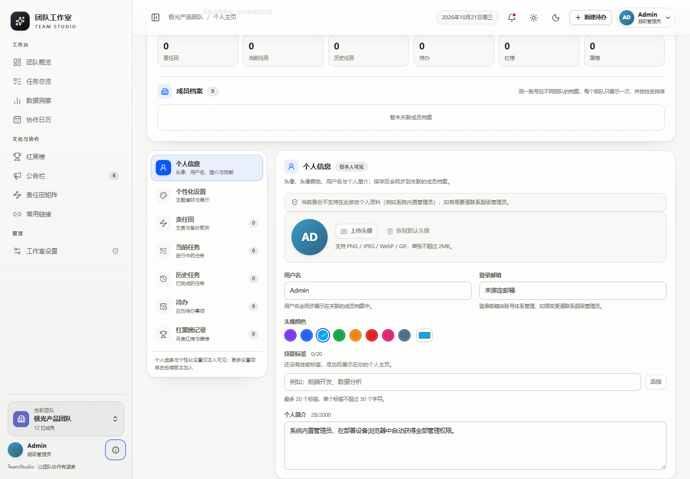

# TeamStudio 团队工作室

一个可本地部署的现代化「团队工作室」全栈应用：**以团队（Team）为唯一组织单位**，围绕成员档案、任务台账与共享标签、工作量负载、数据洞察、协作日历、红黑榜、公告栏、常用链接和可切换表格/网络视图的业务责任田矩阵组织日常协作；提供免密码的**邮箱验证码注册与登录**、个人主页与头像上传、分层的权限与设置（超级管理员 / 团队管理员 / 成员）、可选的**企业 SSO**、可热更新的 JSON 配置，以及**仅通过外部 SMTP 中继**投递验证码邮件（不内置邮件服务器，也不发送日历提醒）。项目刻意**最小化对成员工作的打扰**：不展示个人在线/忙碌等“当前状态”，只收集和呈现团队协作数据。

> 技术栈：Python 3 + FastAPI + SQLite · React 19 + TypeScript + Vite · 原生 CSS 设计系统 · 华为鸿蒙风纸白 / 暗黑双主题 · Monaco（VS Code 同款）JSON 编辑器。前后端同源部署，单进程即可运行。
>
> 当前为 **第 8 轮（round 8）** 架构：只有团队，不再有开发组（Group）、浏览视角（scope）或开发组管理员角色；所有业务数据只按 `team_id` 隔离。旧版本数据会在启动时自动迁移（见「数据迁移」）。第 9 轮只调整界面与入口：工作室/团队设置入口回到左侧边栏「管理」分组（仅对应权限的管理员可见，且不受模块开关控制）；个人设置并入个人主页（左侧「个人信息 / 个性化设置」分栏）；团队切换保留在侧边栏底部（左下角）。

---

## 界面预览

| 纸白主题 · 团队概览 | 暗黑主题 · 团队概览 |
| --- | --- |
|  |  |

| 成员任务总览 / 负载 | 成员任务编辑 |
| --- | --- |
|  |  |

| 成员档案与负载 | 协作日历 / 待办 |
| --- | --- |
|  |  |

| 责任田矩阵（描述列 + 多备份） | 责任田矩阵（网络视图） |
| --- | --- |
|  |  |

| 工作区管理（团队增删） | 成员负载详情（逐任务拆解） |
| --- | --- |
|  |  |

| 责任田按成员筛选 | 红黑榜（月度） |
| --- | --- |
|  |  |

| 数据洞察（当前团队） | 任务标签 |
| --- | --- |
|  |  |

| 自绘下拉框 | 标签库管理 |
| --- | --- |
|  |  |

| 纸白外观与跟随系统预览 | JSON 配置（VS Code 同款 Monaco） |
| --- | --- |
|  |  |

| 管理台（GUI 设置） | 关于 / 模型声明 |
| --- | --- |
|  |  |

| 侧边栏底部团队切换（左下角） | 个人主页 · 个人设置 |
| --- | --- |
|  |  |

| 系统重置（仅系统内置管理员可见） | 最终确认：逐字输入完整站点名称 |
| --- | --- |
|  |  |

| 折叠侧边栏 | 登录页（邮箱验证码） |
| --- | --- |
|  |  |

> 截图可能来自上一轮界面（例如个人设置仍是独立卡片）；第 9 轮已把设置入口放回侧边栏「管理」分组、把个人设置并入个人主页分栏展示，最新界面以实际运行结果为准。

---

## 功能清单

| # | 需求 | 实现 |
|---|------|------|
| 1 | 团队制工作台 | 侧边栏左下角团队切换器，所有业务数据按 `team_id` 隔离；无开发组、无浏览视角、无跨团队聚合；切换团队即时刷新 |
| 2 | 团队成员概览看板 | 成员卡片展示真实头像、职位、角色、标签、简介、多项并行工作、当前负载与近 4 周平均负载；**不展示“当前状态”**；成员卡按姓名排序；抽屉展示当前/历史工作与任务负载 |
| 3 | 协作日历 + 每日待办 | 月视图、日侧栏、新建/编辑/完成/删除待办、优先级、指派成员；不包含邮件提醒设置 |
| 4 | 红黑榜（月度迭代） | 按月切换红榜/黑榜，月度主题、成员、上榜理由、评分；团队管理员可创建/编辑/滚动下月；普通成员与访客只读 |
| 5 | 常用链接贴板 | 分类筛选、搜索、卡片式外链、复制链接；链接按团队维护 |
| 6 | 业务责任田矩阵 | 「业务领域 / 描述 / 负责人 / 备份成员」；表格与网络图两种视图，可按成员查看其主责/备份板块，网络图区分主责实线与备份虚线；每块责任田只有一个主责，但可配置多位备份；负责人/备份成员均显示**真实头像** |
| 7 | 邮箱验证码账号体系 | 免密码注册与登录：邮箱 → 验证码 → 登录；任意有效邮箱可自助注册；超级管理员可预创建账号（角色 + 团队范围），创建时同步返回一次性激活链接并自动复制到剪贴板；**未激活账号同样可以正常走邮箱验证码登录，验证成功即自动激活**（激活链接只是可选快捷方式）；成员档案只能从已注册账号（含未激活账号）中搜索选择 |
| 8 | 个人主页与头像 | 用户菜单「个人主页」：顶部资料卡聚合账号资料与所加入团队的成员档案，下方以设置页式左栏分项展示「个人信息」「个性化设置」「责任田」「当前任务」「历史任务」「待办」「红黑榜记录」（无整体「个人设置」外框，每个分项内容用统一卡片承载，与工作室设置布局一致）；支持上传头像（PNG/JPEG/WebP/GIF，≤2MB）、恢复默认头像、修改用户名、简介、头像颜色与技能标签；**头像会同步到成员卡、抽屉、任务/待办/红黑榜/责任田/洞察/下拉框等所有展示成员的位置**；头部展示管理员的管理范围 |
| 9 | 账号与角色管理 | 超级管理员可在「工作室设置 → 账号与角色」（入口在左侧边栏「管理」分组）中创建、授权、改角色/团队范围、删除账号；创建预创建账号时同步生成一次性激活链接（默认 10 分钟有效，可在设置中调整）；系统内置 Admin 只读表仅系统内置管理员本人可见，不可管理 |
| 10 | 分层权限与设置 | 设置入口由权限决定、位于左侧边栏「管理」分组：超级管理员显示「工作室设置」（站点级：外观、模块、登录、账号、SSO、邮件、JSON），团队管理员显示「团队设置」（仅授权团队的基础信息），成员与访客不显示；设置入口不可被「模块与展示」的开关隐藏；个人设置（个人信息 / 个性化设置）位于个人主页的分栏面板中 |
| 11 | 企业 SSO + 访客回退 | 标准 OIDC 授权码 + PKCE；作为可选的第二种登录方式；未配置或配置不完整时自动进入只读访客模式，不阻塞浏览 |
| 12 | IP / ID 白名单管理员 | 作为 SSO / IP 身份的补充授权路径：按 IP 或身份 ID 授予**团队管理员**范围；系统内置 `Admin` 默认可用，退出后可按普通账号访问 |
| 13 | JSON 配置 + GUI 编辑 | `data/settings.json` 原子写入；管理台提供可视化表单 + 原始 JSON 编辑器（Schema 校验、路径级错误）；新增 `guestModules` 等配置 |
| 14 | 公告栏最多三条置顶 | 置顶上限可配置且硬上限 3；服务端 409/422 双重校验；公告等级、作者、时间；作者头像 |
| 15 | 邮件服务（SMTP 中继） | 仅使用外部 SMTP 中继投递验证码：服务器、端口、账号、密码、发件邮箱/名称、STARTTLS 或 SSL、超时；提供状态、发送日志与测试发信 |
| 16 | 成员任务台账 | 所有成员任务集中总览；进度状态（待完成/进行中/已完成）、健康状态（正常/延期/阻塞）、优先级、难度、预期完成日期、加权负载点数；成员管理自己的任务 |
| 17 | 工作量负载量化 | 任务基础 1 分 + 优先级加成 + 难度加成；每人每周容量 15 分；统计当前与近 4 周滚动平均负载，分级为轻松 / 均衡 / 偏高 / 超载 |
| 18 | 高级双主题 | 鸿蒙纸白 / 暗黑双主题，统一鸿蒙蓝强调色、纸感层次、全站过渡动画；**默认跟随系统明暗并实时切换**，用户可在个人主页「个性化设置」强制选择浅色/深色 |
| 19 | 访客模块访问控制 | 超级管理员可逐模块设置访客（未登录访问者）可访问哪些模块；前端导航/路由与后端接口双重校验；默认放行除「工作室设置」外的全部模块，设置模块恒为启用且不参与模块隐藏与访客开关 |
| 20 | 任务标签 | 每个团队共享一套标签库，所有人可新建、改名、换色、删除；任务支持多选标签（最多 8 个），任务总览支持按标签筛选与标签库管理 |
| 21 | 数据统计与分析 | 独立「数据洞察」模块：KPI、日/周趋势柱状图、成员可排序表；时间跨度从近 1 周到全部时间；按当前团队统计 |
| 22 | 成员负载明细 | 任务总览的「成员负载」卡片可点击：查看该成员当前/平均负载、周容量、阻塞与逾期，以及每项任务的「基础 + 优先级 + 难度」点数构成 |
| 23 | 工作区结构管理 | 用户菜单「工作区管理」：按权限域创建/删除团队，展示成员数；删除使用输入完整名称的二次确认，级联清理该团队业务数据并写入审计 |
| 24 | 系统重置 | 「工作室设置 → 重置系统」仅系统内置 Admin 可见；双重确认后恢复默认设置、清空全部数据、物理擦除数据库并轮换会话密钥；启动过程从不自动写入演示数据 |

除此之外还包括：可折叠侧边栏（状态持久化）、关于弹窗与模型声明、水墨纸感层次、页面/卡片/负载条动画、响应式布局、审计日志、脚本化演示数据（`scripts/seed-demo.ps1`）、API 文档、自动化测试。

---

## 快速开始

```powershell
# 1. 安装依赖（Python venv + 前端依赖）
.\scripts\setup.ps1

# 2. 写入演示数据（可选，幂等）
.\scripts\seed-demo.ps1

# 3. 启动（默认 http://127.0.0.1:8000）
.\scripts\start.ps1
```

- 应用：<http://127.0.0.1:8000>
- API 文档：<http://127.0.0.1:8000/api/docs>
- 健康检查：<http://127.0.0.1:8000/api/health>

常用参数：

```powershell
# 指定端口 / 不自动打开浏览器 / 开发热重载
.\scripts\start.ps1 -Port 8080 -NoBrowser
.\scripts\start.ps1 -Reload

# 只构建前端静态资源
.\scripts\build.ps1

# 只跑全部校验（后端测试 + 前端类型检查 + 构建）
.\scripts\verify.ps1
```

> 服务启动过程**不会**自动创建演示数据：全新数据库启动后是干净的空系统。演示数据只由 `scripts/seed-demo.ps1` 显式写入（幂等），因此系统重置后重启服务器不会重新出现演示数据。

### 开发模式

```powershell
# 终端 1：后端
.\.venv\Scripts\python.exe -m uvicorn backend.app.main:app --reload --port 8000

# 终端 2：Vite（自动代理 /api 到 8000）
npm run dev --prefix web
# 访问 http://127.0.0.1:5173
```

### 环境变量

| 变量 | 说明 |
| --- | --- |
| `TEAMSTUDIO_DATA_DIR` | 数据目录（默认 `<repo>/data`） |
| `TEAMSTUDIO_DB` | SQLite 路径（默认 `<data>/teamstudio.db`） |
| `TEAMSTUDIO_SETTINGS` | 设置文件路径（默认 `<data>/settings.json`） |
| `TEAMSTUDIO_SESSION_SECRET` | 固定会话签名密钥（默认自动生成并写入 `data/.session_secret`） |
| `TEAMSTUDIO_DEVICE_IPS` | 追加视为“部署设备本机”的 IP/CIDR（逗号分隔，用于反向代理等特殊部署） |
| `TEAMSTUDIO_TRUST_PROXY` | 兼容旧部署的代理信任开关；设备管理员判定已默认只在本机直连/本机反代场景信任转发头 |

---

## 账号与登录

默认登录方式为**邮箱验证码**，无需密码；企业 SSO 作为可选的第二种方式保留。

1. 登录页输入邮箱 → 获取六位验证码（默认 10 分钟有效，60 秒重发间隔）。
2. 输入验证码完成登录。未注册邮箱会自动创建为「成员」账号。
3. **预创建但未激活的账号同样可以正常用邮箱验证码登录**；验证码校验成功时会自动标记为已激活。一次性激活链接仍可用于快捷登录（默认 10 分钟有效），但不是登录前置条件。
4. 登录成功后写入 HMAC-SHA256 签名的 HttpOnly 会话 Cookie；**默认 7 天滑动续期**：每次访问 `/api/bootstrap` 或 `/api/auth/me` 都会重新签发。有效期可在「工作室设置 → 访客与登录策略」中调整（设置入口位于左侧边栏「管理」分组）。
5. 登录页始终提供「以访客身份浏览」；配置企业 SSO 后还会显示「使用企业 SSO 登录」。访客不会被自动跳转到登录页。
6. **部署设备管理员**：当请求的真实来源 IP 与部署设备一致（loopback、本机网卡、本机局域网 IP，或本机反向代理转发的本机 IP）时，浏览器自动获得系统内置 `Admin` 身份；远程 IP 不可。登录页会说明这一规则，并提供「以系统内置管理员身份登录」恢复入口。

相关 API：`POST /api/auth/email/request`、`POST /api/auth/email/verify`、`GET /api/auth/activate?token=`（预创建账号一次性激活链接）、`GET /api/auth/config`、`GET /api/auth/me`、`POST /api/auth/logout`、`POST /api/auth/device/login`、`POST /api/users/{id}/activation-link`；SSO 为 `GET /api/auth/login`、`GET /api/auth/callback`。验证码只保存 HMAC 哈希；激活令牌只保存 SHA-256 哈希。未配置 SMTP 时邮箱接口返回 `503 email_not_configured`。

---

## 团队与数据隔离

- **只有团队**：第 8 轮起不再有开发组、浏览视角（开发组/当前团队/所有团队）或 `group_admin` 角色；所有业务数据（成员、任务、待办、红黑榜、链接、责任田、公告、标签、工作项）只按 `team_id` 隔离。
- 侧边栏底部「当前团队」切换器用于在多个团队之间切换；每个团队拥有独立的业务数据与成员名册，面包屑显示「团队名 / 页面名」。
- 同一账号可以加入多个团队（每个团队一条成员档案）；个人主页按团队逐条展示。成员卡与抽屉展示该成员所属团队。
- 接口基址统一为 `/api/teams/{team_id}/...`；不再接受/返回 `scope` 参数，也不再返回 `groupId/groupName`。

---

## 个人主页与成员档案

- 用户菜单 →「个人主页」（`#/profile`）：顶部资料卡展示账号头像、用户名、邮箱、角色徽章、负载统计，并**把成员档案整合在顶部资料卡内**（每个团队一条，按姓名排序）；责任田、当前任务、历史任务、待办与红黑榜记录放在下方设置页式左栏的对应分项中。
- 成员档案卡与概览成员卡均**按姓名排序**（中文按拼音，基于 `Intl.Collator("zh-Hans-CN")`）。
- **不展示个人“当前状态”**：成员卡片、抽屉、个人主页、头像状态点均不再出现可用/忙碌/远程/离线等状态（任务进度、健康状态、待办完成状态等业务状态保留）。
- **头像同步**：上传/更换头像后会同步到所有团队档案，以及成员卡、抽屉、任务、待办、红黑榜、责任田、数据洞察、成员/负责人/备份下拉框等全部展示位置。
- 编辑权限按字段区分：**个人信息**（姓名、邮箱、简介、头像、头像颜色、标签、技能）仅超级管理员或本人可改；**组织信息**（职位、团队角色）由权限范围内的团队管理员维护。
- **个人设置（设置页式分栏）**：个人主页下方与「工作室设置」保持同一布局——左侧为分项导航，右侧每个分项各自以卡片承载内容（个人信息、个性化设置与责任田/任务/待办/红黑榜记录一致），不再有整体「个人设置」卡片外框。本人可见的分项依次为「个人信息」（头像、用户名、简介、头像颜色、技能标签）、「个性化设置」（跟随系统 / 浅色 / 深色），随后是「责任田」「当前任务」「历史任务」「待办」「红黑榜记录」；查看他人主页时只显示公开协作记录分项。后续设置项可按同一模式继续增加。

---

## 成员任务与工作量负载

- 任务字段：标题、说明、所属成员、进度状态、健康状态、优先级、难度、预期完成日期、标签。
- 负载点数：基础 1 + 优先级（低 0 / 普通 1 / 高 2 / 紧急 3）+ 难度（简单 0 / 中等 1 / 困难 2），单项任务 1–6 分；每人每周容量 15 分。
- 统计当前负载与近 4 周滚动平均负载，分级为轻松 / 均衡 / 偏高 / 超载；点击成员负载卡片可查看逐任务点数拆解。
- **个人编辑**：普通成员登录后只能新增/修改/删除自己的任务；团队管理员/超级管理员可管理范围内任意成员任务；访客只读。

---

## 任务标签（团队内共享）

- 每个团队拥有一套共享标签库（`task_tags` 表），**所有登录成员**都可以新增、重命名、换色、删除，无需管理员权限。
- 任务支持多选标签（最多 8 个）；任务总览支持按标签筛选与标签库管理。
- 首次访问某个团队时若无标签，会自动初始化 5 个常用标签（如「前端」「后端」「体验」「数据」「协作」）。

---

## 数据洞察

- 独立「数据洞察」模块，按当前团队统计：KPI、日/周趋势柱状图、成员可排序表。
- 时间跨度：近 1 周 / 2 周 / 1 月 / 2 月 / 3 月 / 全部。
- API：`GET /api/teams/{team}/insights?range=1w|2w|1m|2m|3m|all`。

---

## 责任田矩阵

- 字段：业务领域、描述、负责人（唯一）、备份成员（多位）、沟通渠道、联系方式。
- 表格视图与网络图视图；网络图区分主责实线与备份虚线；可按成员筛选其主责/备份板块。
- 负责人与备份成员在矩阵、网络图和下拉框中均展示真实头像。
- 同一成员可同时负责或备份多块责任田。

---

## 权限模型

| 身份 | 识别方式 | 权限 |
| --- | --- | --- |
| **超级管理员（系统内置 Admin）** | 请求真实来源 IP 与部署设备一致，且该浏览器未主动退出系统内置管理员身份 | 所有团队内容、站点设置、账号与角色、企业 SSO、邮件服务；可创建 / 删除任意团队；名称固定 `Admin`，不出现在配置文件中；可退出并在登录页恢复 |
| **超级管理员（存储在册）** | 账号角色 `super`（邮箱验证码 / SSO 登录） | 站点设置、账号与角色、所有团队内容；不能执行仅系统内置 Admin 可用的「系统重置」 |
| **团队管理员** | 账号角色 `team_admin` + `team_ids`，或 ID/IP 白名单 | 授权团队的全部业务内容与管理；不能创建/删除团队、不能读取站点设置，只能编辑领域级「团队设置」 |
| **成员** | 邮箱验证码登录（自助注册或预创建，未激活也可登录） | 个人主页与本人资料、自己的工作项、自己的任务与待办；全局只读；可加入多个团队 |
| **访客** | 未登录访问 | 只读，且仅能访问管理员放行的访客模块 |

- **访客模块访问控制**：工作室设置（左侧边栏「管理」分组）→「模块与展示 → 访客可访问模块」可逐模块放行；未放行的模块前端导航隐藏、直接访问页面显示提示，后端接口返回 `403 guest_module_disabled`。设置模块恒为启用、不在模块开关列表中，也不会对访客开放。
- **系统内置管理员可退出**：直接用浏览器访问部署设备地址时默认成为 `Admin`，这是应急恢复入口；退出后本机浏览器会记住退出状态，可改用任意邮箱账号登录，该账号不附带系统内置管理员权限。登录页顶部会显示「以系统内置管理员身份登录」按钮，可随时恢复内置 `Admin`。
- **系统重置只有系统内置 Admin 能做**：存储在册的 `super` 账号即使在本机登录也只拥有普通超管权限，看不到「重置系统」标签页，接口返回 `403 device_admin_required`。

---

## 主题与个性化

- 默认**跟随系统**（`prefers-color-scheme`），操作系统切换明暗时页面实时跟随，无需刷新。
- 个人主页 →「个人设置 → 个性化设置」可强制选择「浅色 / 深色 / 跟随系统」，选择持久化在当前浏览器（`localStorage`），优先于系统。
- 站点级外观仍可配置强调色、辅助色与圆角；**站点设置不再决定明暗模式**（`site.theme.mode` 字段仅为旧配置兼容保留）。
- 顶栏主题按钮提供快速切换与三选一菜单。

---

## 工作区管理

- 有权管理员可从右上角用户菜单打开「工作区管理」，维护团队结构：
  - **超级管理员**：可创建 / 删除任意团队；
  - **团队管理员 / 成员 / 访客**：没有结构管理入口（团队管理员可在「团队设置」中编辑自己团队的基础信息）。
- 删除是**输入名称的二次确认**：必须完整输入团队名称，确认按钮才会解锁；名称不匹配时接口返回 `422 confirm_mismatch`。
- 删除团队会级联删除其下成员、工作项、任务、待办、红黑榜、链接、责任田、公告与任务标签，并写入审计日志。
- API：`GET /api/workspace/manage`、`POST /api/workspace/teams`、`DELETE /api/workspace/teams/{teamId}`（删除请求体 `{ "confirmName": "完整名称" }`）。

---

## 企业 SSO 配置

邮箱验证码是默认登录方式；企业 SSO 是可选的身份接入方式。配置后登录页会显示「使用企业 SSO 登录」。

工作室设置（左侧边栏「管理」分组）→「企业 SSO」，或直接编辑 JSON：

```json
{
  "auth": {
    "sso": {
      "enabled": true,
      "providerName": "企业 SSO",
      "issuer": "https://sso.example.com",
      "clientId": "teamstudio",
      "clientSecret": "••••••",
      "scopes": "openid profile email",
      "redirectUri": "http://127.0.0.1:8000/api/auth/callback",
      "authorizationEndpoint": "",
      "tokenEndpoint": "",
      "userinfoEndpoint": "",
      "endSessionEndpoint": "",
      "claimId": "sub",
      "claimName": "name",
      "claimEmail": "email",
      "allowedEmailDomains": [],
      "autoProvision": false
    }
  }
}
```

- 默认使用 OIDC Discovery：`{issuer}/.well-known/openid-configuration`；若企业 IdP 不提供 discovery，可手动填写三个端点。
- 支持 PKCE、`state` Cookie、`claimId/claimName/claimEmail` 映射与允许邮箱域限制。
- 配置不完整时登录自动回退访客模式，不阻塞浏览。

---

## 管理员白名单

白名单是 SSO / IP 身份的**补充授权路径**（主路径仍是账号与角色），可在工作室设置 →「成员与权限」可视化维护，也可编辑 JSON。

- 分为 `ips` 与 `ids` 两组；角色只支持 `team_admin`（团队管理员），需要指定 `teamId`。
- IP 支持单 IP 和 CIDR；ID 会与 SSO / 邮箱账号的 id、邮箱、`sub` 匹配（忽略大小写）。
- 系统内置 `Admin` 默认可用，不写入配置；退出后可按普通账号访问。

```json
{
  "auth": {
    "adminWhitelist": {
      "ips": [
        { "ip": "10.20.30.0/24", "name": "研发楼层", "role": "team_admin", "teamId": "team-aurora", "note": "" }
      ],
      "ids": [
        { "id": "lin.zhixia@corp.example", "name": "林知夏", "role": "team_admin", "teamId": "team-aurora", "note": "" }
      ]
    }
  }
}
```

---

## 邮件服务（SMTP 中继）

邮件只用于**投递账号验证码**，并且只支持通过外部 SMTP 中继发送：不内置 SMTP 服务器，不提供本地邮件中心，也不发送日历邮件提醒。

```json
{
  "email": {
    "enabled": true,
    "smtp": {
      "host": "smtp.corp.example",
      "port": 587,
      "username": "teamstudio@corp.example",
      "password": "••••••",
      "fromEmail": "teamstudio@corp.example",
      "fromName": "团队工作室",
      "useStartTls": true,
      "useSsl": false,
      "timeoutSeconds": 15
    },
    "subjectTemplate": "[{{siteName}}] 邮箱验证码",
    "bodyTemplate": "你好：\n\n你正在登录「{{siteName}}」，本次验证码为：\n\n{{code}}\n\n验证码 {{expiresMinutes}} 分钟内有效，请勿转发给他人。\n\n—— {{siteName}}"
  }
}
```

1. `email.enabled = true` 且填写 `smtp.host` 与发件邮箱后，验证码邮件才会发送；否则登录接口返回 `503 email_not_configured`。
2. 支持 STARTTLS 或 SSL（二选一）、超时设置；密码不会出现在任何接口或日志中。
3. 管理台提供「测试发送」、中继状态与最近发送日志（收件邮箱脱敏）；`GET /api/email/status`、`GET /api/email/logs`、`POST /api/email/test`。
4. SMTP 密码以明文保存在 `data/settings.json`（JSON 可直接编辑的取舍）。请使用应用专用密码，限制数据目录权限，并避免把该文件提交到版本库。

---

## JSON / GUI 双模式设置

- **入口**：设置入口只由权限决定，位于左侧边栏「管理」分组——超级管理员显示「工作室设置」，团队管理员显示「团队设置」，成员与访客不显示；入口不受「模块与展示」的模块开关控制（无法被隐藏）。
- **站点级（超级管理员「工作室设置」）**：「外观与站点」「模块与展示（含访客可访问模块）」「访客与登录策略」「成员与权限（账号/角色/白名单）」「企业 SSO」「邮件服务」「高级 JSON」；系统内置 Admin 还会看到仅自己可见的「重置系统」。
- **领域级（团队管理员「团队设置」）**：只能编辑授权团队的基础信息，不能读取站点配置。
- **GUI 模式**：站点与主题、模块开关、访客模块、公告置顶策略、日历展示偏好、红黑榜文案、功能开关、邮箱验证码参数、会话保持天数、白名单、账号与角色、企业 SSO、SMTP 中继与验证码模板。
- **高级 JSON 模式（超级管理员）**：完整设置对象，VS Code 同款 Monaco 编辑器（行号、语法高亮、错误波浪线），支持格式化、后端 Schema 校验、逐路径错误提示、校验通过后保存；Schema 可通过 `GET /api/settings/schema` 获取。

---

## 项目结构

```text
TeamStudio/
├─ backend/
│  ├─ app/
│  │  ├─ main.py              # FastAPI 入口、静态资源与错误处理
│  │  ├─ config.py           # 设置 Schema、Settings v3（含 guestModules）、原子 JSON 存储
│  │  ├─ db.py               # SQLite Schema（团队制）与旧库自动迁移
│  │  ├─ auth.py             # 会话、设备管理员判定、CurrentUser 与角色权限
│  │  ├─ permissions.py      # 读写/团队管理员/访客模块校验
│  │  ├─ http.py             # 响应封装、get_team/get_member 等
│  │  ├─ sso.py              # OIDC Discovery + 授权码 + PKCE
│  │  ├─ seed.py             # 演示团队/成员/工作/待办/榜单/任务数据
│  │  └─ routers/            # auth / bootstrap / workspace / tasks / boards /
│  │                         # calendar / insights / profile / users / settings /
│  │                         # workspaces / system / email
│  └─ tests/                 # pytest（团队制 API、迁移、头像、访客模块、账号等）
├─ web/
│  ├─ src/
│  │  ├─ store.tsx           # 工作区上下文、团队切换、跟随系统主题、权限
│  │  ├─ api.ts              # /api/teams/{team} 风格的前端 API 客户端
│  │  ├─ types.ts            # 前端类型（团队制模型）
│  │  ├─ pages/              # 概览/任务/日程/洞察/红黑榜/链接/矩阵/公告/个人主页/设置
│  │  └─ components/         # AppShell、Avatar、Select、MultiSelect、抽屉、弹窗等
│  └─ e2e/                   # Playwright 冒烟与验收脚本
├─ scripts/                  # setup / build / start / seed-demo / verify
├─ data/                     # SQLite、settings.json、上传头像（运行时生成，勿提交）
├─ docs/                     # 历史轮次契约与截图
│  ├─ ROUND9_CONTRACT.md     # 第 9 轮设置入口与侧边栏团队切换契约（当前界面基准）
│  └─ ROUND8_CONTRACT.md     # 第 8 轮团队制架构契约
├─ CONTRACT.md               # 历史 API 契约（第 6 轮前，供追溯）
```

---

## 开发与测试

```powershell
# 后端测试
.\.venv\Scripts\python.exe -m pytest backend\tests -q

# 前端类型检查 / 构建
npm run typecheck --prefix web
npm run build --prefix web

# 一键校验（后端测试 + 类型检查 + 构建）
.\scripts\verify.ps1
```

- 后端测试覆盖：团队制 API、成员/任务/待办/红黑榜/链接/责任田/公告、标签、洞察、个人主页与头像、账号与角色、访客模块、设备管理员判定、设置与旧库迁移、系统重置等。
- Playwright e2e 脚本位于 `web/e2e/`；常用：`npm run e2e:smoke --prefix web`（需先构建 `web/dist` 并启动后端）。
- 性能/视觉冒烟：`npm run e2e:screenshots --prefix web`。
- 第 8 轮验收重点：无开发组/浏览视角、主题实时跟随系统、访客模块开关、未激活账号可登录、部署设备管理员 IP 判定、全站头像同步、成员卡按姓名排序。
- 第 9 轮验收重点：团队切换保留在侧边栏底部（左下角，面包屑显示「团队名 / 页面名」）、侧边栏「管理」分组按权限显示「工作室设置」/「团队设置」（非管理员不显示）、头像下拉不再有设置入口、「模块展示」只有 8 个普通模块开关且无设置开关、设置入口无法被模块开关隐藏、个人主页提供「个人信息 / 个性化设置」分栏式个人设置。

---

## 数据迁移（第 8 轮）

- 旧数据库（含 `groups` 表与 `group_id` 字段）在启动时自动迁移：所有开发组数据并入其所属团队，业务表重建为 `team_id`，行 id 与外键关系保留。
- 同团队同月份的红黑榜合并到最早创建的一张榜（条目按侧重新排序）；同团队同名标签自动重命名为 `名称 (2)`、`名称 (3)`，原有引用保持有效。
- 账号 `group_admin` 自动迁移为 `team_admin`，其开发组所属团队并入 `team_ids`。
- `data/settings.json` 自动升级到版本 3：新增 `guestModules`，清理白名单中的 `groupIds/group_admin`，旧 `site.theme.mode` 保留兼容。
- 迁移是幂等的，并用 `app_meta.schema_round8_migrated` 标记；迁移失败会回滚并阻止启动（避免写入半迁移数据）。迁移前请先备份 `data/`。

---

## 数据备份与安全

- 备份内容：`data/teamstudio.db`、`data/settings.json`、`data/.session_secret` 与 `data/uploads/`（个人头像）。SQLite 使用 WAL，建议停机备份或使用 SQLite 在线备份。
- 本机访问自动获得 `Admin` 是为了防止锁死；**不要把 8000 端口无保护地暴露到公网**。
- 设备管理员判定基于真实 TCP 来源 IP：本机 loopback、本机网卡地址、本机 LAN IP 或本机反向代理转发的本机 IP 视为部署设备；远程 IP 不会获得内置 Admin。若使用反向代理，请确保代理会追加/覆盖 `X-Forwarded-For`，必要时设置 `TEAMSTUDIO_DEVICE_IPS`。
- 邮箱验证码只保存 HMAC 哈希，明文验证码不落库、不写日志；发送日志中的收件邮箱经过脱敏；SMTP 密码不会出现在日志中。
- `data/settings.json` 可能包含 SMTP 密码与白名单等敏感信息，请限制数据目录权限，避免提交到版本库。
- **系统重置不可撤销**：仅系统内置 Admin 可执行，会恢复默认设置、清空全部业务与账号数据、删除上传头像、物理擦除数据库文件并轮换会话密钥。需要保留的数据请先备份 `data/`；重置后系统保持空状态（不会重新灌入演示数据）。

---

## 常见问题

**Q：为什么侧边栏没有“开发组”和“浏览视角”了？**  
第 8 轮起产品只保留团队这一种组织单位，所有数据按团队隔离。请在侧边栏底部（左下角）切换团队；同一团队的成员、任务、待办等共享一套数据。

**Q：团队切换器在哪里？**  
第 9 轮起仍在侧边栏底部（左下角），显示团队徽标 + 团队名 + 成员数，点开向上展开的下拉即可切换团队；面包屑显示「团队名 / 页面名」。

**Q：设置入口在哪里？为什么「模块展示」里没有“工作室设置”开关？**  
设置入口只由权限决定，位于左侧边栏「管理」分组：超级管理员显示「工作室设置」，团队管理员显示「团队设置」，成员与访客不显示。它不受「模块与展示」的模块开关控制——设置模块恒为启用，无法通过模块开关隐藏。

**Q：个人设置在哪里？**  
登录后打开「个人主页」（右上角头像菜单 →「个人主页」），页面下方与「工作室设置」保持同一布局：左侧为「个人信息」「个性化设置」「责任田」「当前任务」「历史任务」「待办」「红黑榜记录」等分项，右侧每个分项都用统一的卡片承载内容；成员档案已整合到顶部资料卡中。

**Q：为什么成员卡片上没有“当前状态”？**  
本项目设计目标之一是尽量减少对成员工作的打扰，因此不要求成员维护在线/忙碌状态，也不展示该字段。

**Q：为什么成员卡和其他页面头像不一致？**  
第 8 轮已修复：账号头像会同步到所有团队档案与所有展示位置（含责任田负责人/备份成员下拉框、任务、待办、红黑榜、洞察等）。若头像刚上传，请刷新页面。

**Q：预创建账号未激活，能直接登录吗？**  
可以。输入该账号邮箱获取验证码并完成验证即可，验证成功后自动激活。一次性激活链接只是可选的快捷方式。

**Q：为什么本机用局域网 IP 访问时也能成为系统内置管理员？**  
判定依据是真实来源 IP 是否与部署设备一致；在部署机器上通过本机 LAN IP/主机名访问同样属于本机。远程设备不会获得内置 Admin。

**Q：切换系统明暗后页面没变化？**  
请检查个人主页 →「个人设置 → 个性化设置」是否被强制为浅色/深色；选择「跟随系统」后页面会实时响应系统切换。浏览器还需支持 `prefers-color-scheme`。

**Q：访客看不到某个模块？**  
管理员可在「工作室设置 → 模块与展示 → 访客可访问模块」中放行（入口在左侧边栏「管理」分组）。未放行时前端隐藏入口，后端接口也会返回 403。

**Q：收不到验证码邮件？**  
先在「工作室设置 → 邮件服务」确认 `email.enabled` 已开启、SMTP 主机/端口/账号/密码/发件邮箱正确，并点击「测试发送」；也可查看 `GET /api/email/status` 的最近错误与发送日志。注意 60 秒重发间隔与 10 分钟有效期，并检查垃圾邮件目录。未配置 SMTP 时接口返回 `503 email_not_configured` 属于预期提示。

**Q：系统重置后为什么没有演示数据？**  
演示数据不会随服务启动自动写入。需要时停服后运行 `.\scripts\seed-demo.ps1`（幂等）再启动。`data/settings.json` 不受影响。

**Q：旧版本升级后数据会丢吗？**  
启动时会自动迁移旧库（开发组并入团队），迁移前建议先备份 `data/`。迁移失败会阻止启动并回滚。

---

## 构建与模型声明

本项目由 **DeepSeek Flash 模型**（当前推理服务暴露的模型版本标识：`deepseek-flash`，推理强度 `high`）通过 **DeepSeek Harness** 的 Agent Team 协作完成。产品设计、前后端实现、联调与自动化验收均由模型代理执行。

应用内「关于团队工作室」弹窗（侧边栏信息按钮或用户菜单）可查看完整构建信息。若企业交付需要替换为指定的数字模型版本，只需修改 `web/src/components/AboutDialog.tsx` 中的 `BUILD_INFO` 常量并重新构建。
